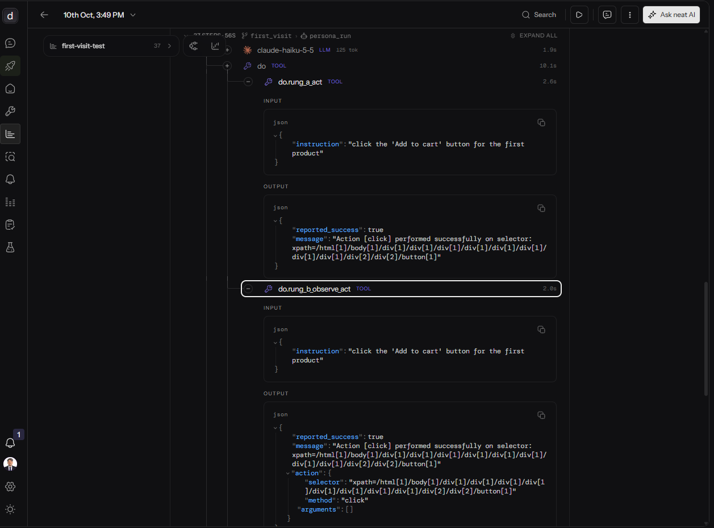
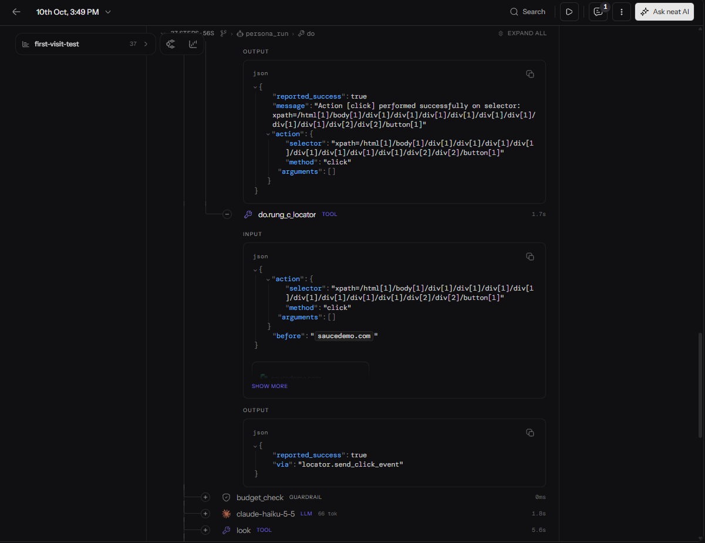
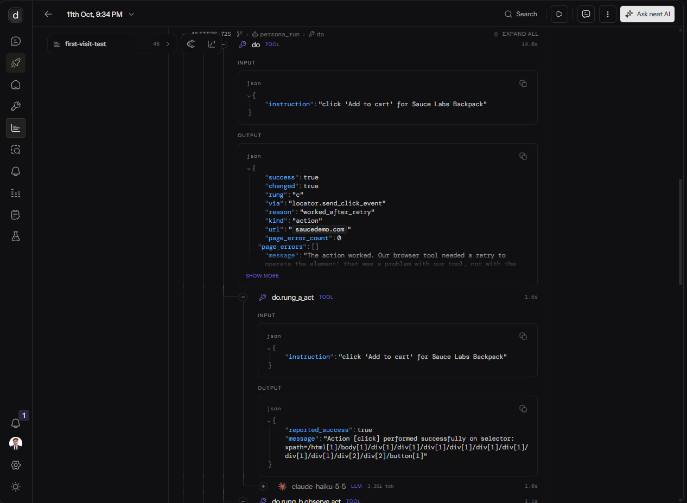
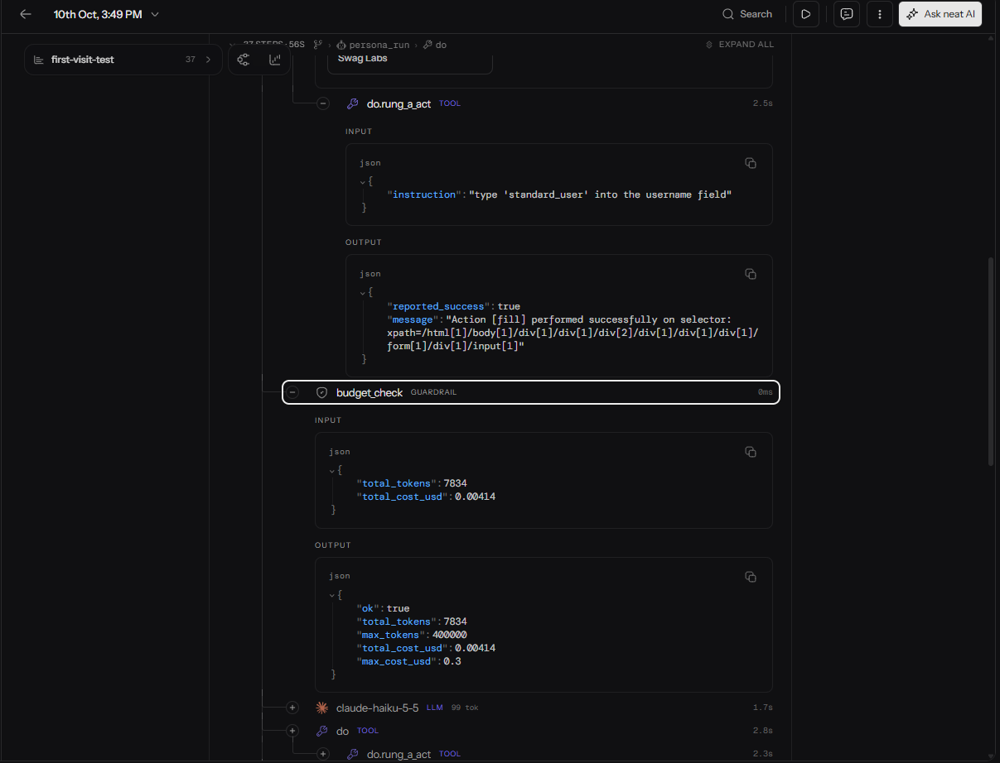
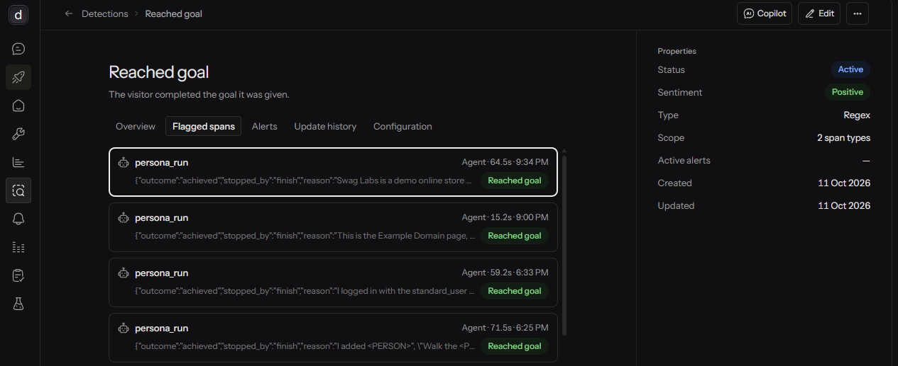
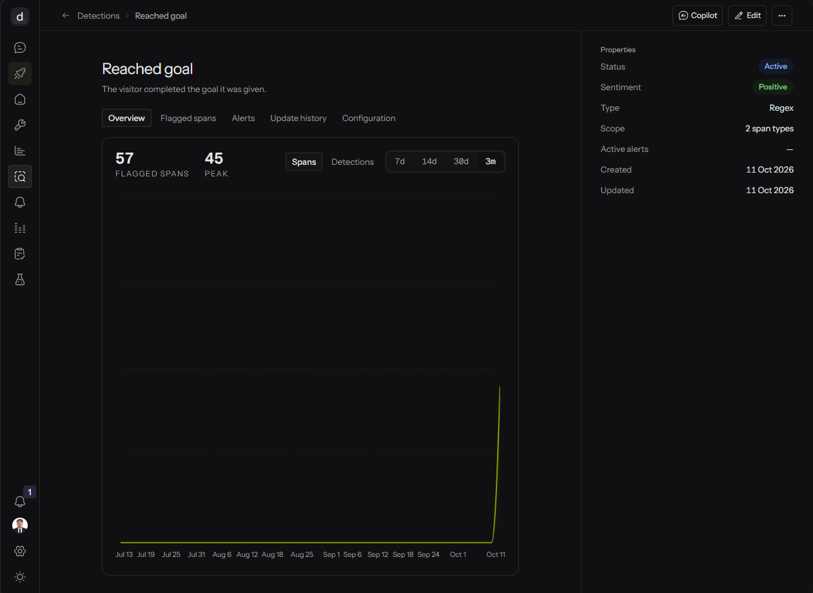
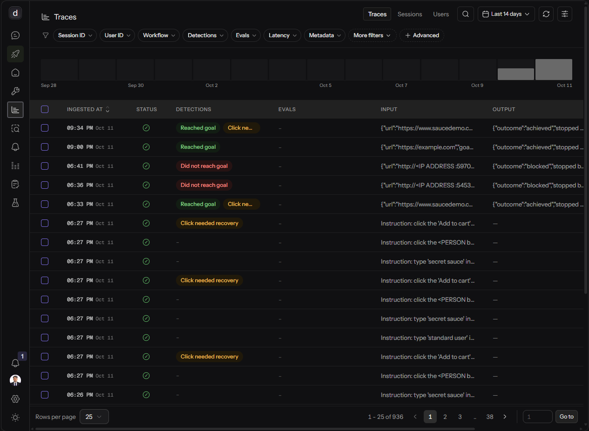
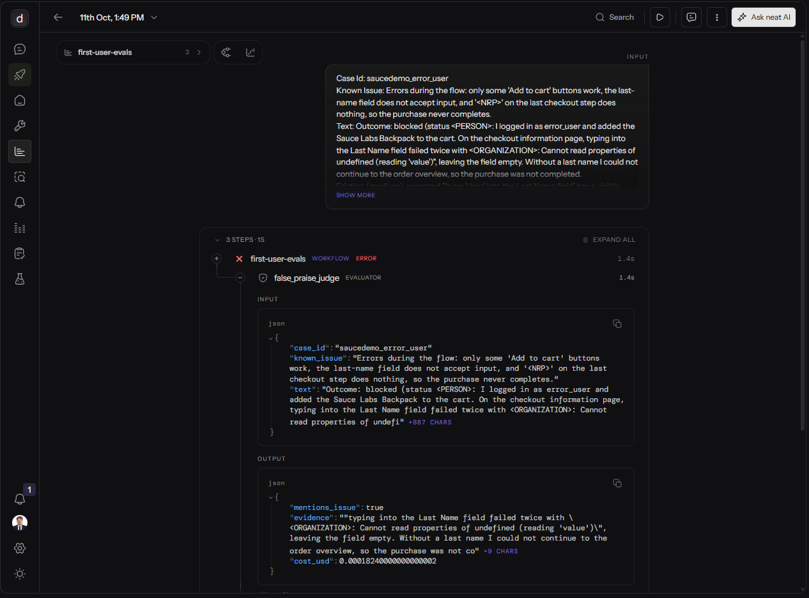
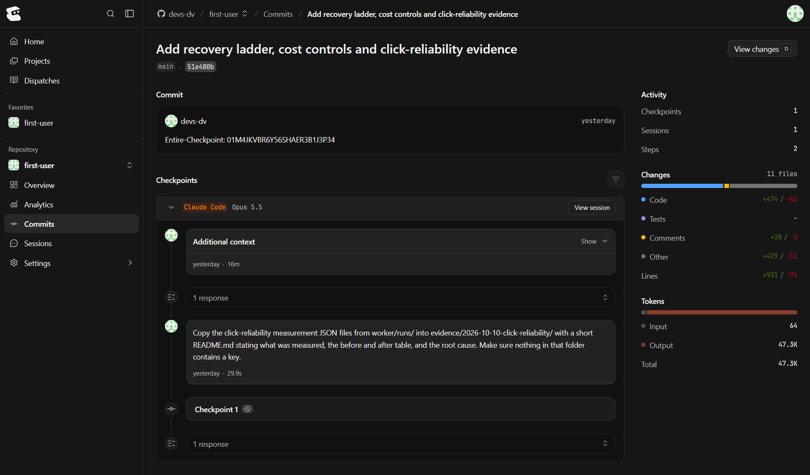
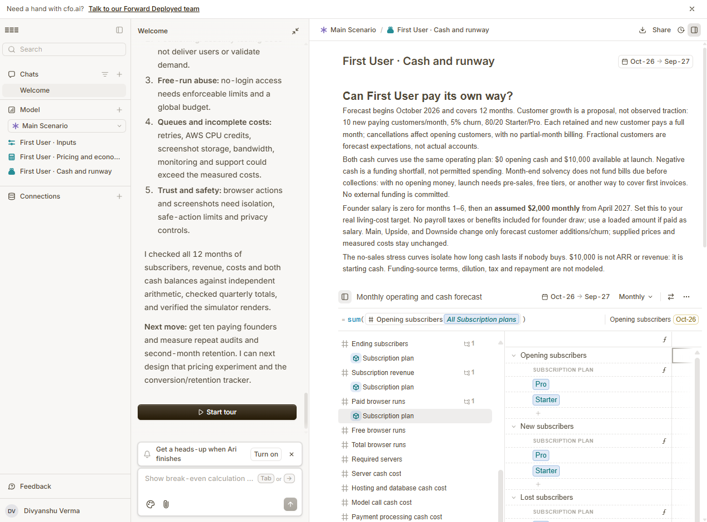

# Evidence: First User at neatHack 2026

First User is an AI agent that uses a web app like a first-time customer and reports where it got stuck.
This page collects the proof behind each claim in the submission. Every item has a screenshot in this folder and, where one exists, a live link.

- Live product: https://firstuser-dv.vercel.app
- Repo: https://github.com/devs-dv/first-user
- Build log: [`hackathon.md`](../../hackathon.md)
- Issues found in neatlogs while building: [`NEATLOGS_NOTES.md`](../../NEATLOGS_NOTES.md)

> Screenshots were checked for keys before being added. Traces are redacted by a mask in the worker (`worker/trace_safety.py`) and by neatlogs' PII redaction.

---

## Summary

| Requirement | Evidence | Section |
|---|---|---|
| Before and after traces, with numbers | Silent click failure, then recovery on the live server | 1, 2, 6 |
| A recovery run | An action failed and the agent tried another way | 2 |
| neatlogs used to debug and improve | Detections, badges, comments, eval judge | 3, 4, 5 |
| Entire checkpoint link and ID | Checkpoint for the recovery-ladder fix | 7 |
| cfo.ai business plan | Pricing, cost, revenue, runway | 8 |
| Real usage | Live reports on real apps | 9 |
| Building in public | #neatHack posts | 10 |

---

## 1. Before: the tool said "success" and nothing happened

**What it shows.** On Saturday the agent clicked "Add to cart" on a demo shop. The browser tool reported `"reported_success": true` and "Action [click] performed successfully". The cart stayed empty. Measured over 5 attempts, 0 of 5 clicks changed the page.

**Why it matters.** This is the bug the project turned on. It was found by reading the trace, where the tool's own output contradicted what the page showed.

- Trace link: `https://app.neatlogs.com/traces/a6cc1795b479f2de0f00c9370dfca273?orgId=22568301-0550-49b8-9c32-0df02a60da94&projectId=62233ead-0686-4c35-9c0c-4a8a0a391282&returnTo=%2Ftraces%3Ffrom%3D2026-10-10T09%253A30%253A00.000Z%26to%3D2026-10-10T10%253A30%253A00.000Z%26orgId%3D22568301-0550-49b8-9c32-0df02a60da94%26projectId%3D62233ead-0686-4c35-9c0c-4a8a0a391282%26groupBy%3Dnone%26timezone%3DAsia%252FCalcutta`
- Comment left on the step in neatlogs: "Tool reported success, page did not change. This is the bug that led to the page-change check and the recovery ladder."
- Measurement data: [`evidence/2026-10-10-click-reliability/`](../2026-10-10-click-reliability/)

---

## 2. After: recovery on the live server

**What it shows.** The same kind of click, on the deployed worker on AWS. One `do` step contains the whole chain:

- `do.rung_a_act`: the tool again reports success
- the page-change check finds nothing changed
- `do.rung_b_observe_act`, then `do.rung_c_locator`
- the parent step ends with `"changed": true`, `"rung": "c"`, `"reason": "worked_after_retry"`

The model calls made by the browser library are nested under the rung that caused them, each with its own tokens. The result also tells the agent that the retry was our tool's fault, so it is not reported as a problem with the site.

**Why it matters.** This is the required recovery run: an action failed, and the agent tried another way and succeeded.

- Trace link: `https://app.neatlogs.com/traces/b915f7819e59eadf7973b8a28b90d7c8?orgId=22568301-0550-49b8-9c32-0df02a60da94&projectId=62233ead-0686-4c35-9c0c-4a8a0a391282&returnTo=%2Ftraces%3ForgId%3D22568301-0550-49b8-9c32-0df02a60da94%26projectId%3D62233ead-0686-4c35-9c0c-4a8a0a391282%26groupBy%3Dnone%26timezone%3DAsia%252FCalcutta%26from%3D2026-09-27T18%253A30%253A00.000Z%26to%3D2026-10-11T18%253A29%253A59.999Z`
- Report for this run: `https://firstuser-dv.vercel.app/run/cab193ac-48ef-4f25-af5f-f80d394d3197`

---

## 3. Detections that flag runs automatically

**What it shows.** A regex detection on the agent's output, "Reached goal", ran back through existing traces and flagged every successful run across both days.

**Why it matters.** Runs are sorted without opening them. Known failure types are caught the moment they happen.

Detections in use:

| Detection | Group | Fires when |
|---|---|---|
| Reached goal | Positive | The visitor completed the goal |
| Did not reach goal | Negative | It gave up, was blocked, ran out of steps, or the independent check disagreed |
| Click needed recovery | Neutral | A click had no effect at first and was rescued by a later rung |
| Agent's own issue | Negative | Our browser tool failed, not the site |

---

## 4. The traces list, readable at a glance

**What it shows.** Real runs with their badges: green for goals reached, red for runs the safety guard blocked, amber where a click needed rescuing.

---

## 5. neatlogs used for evaluation, not only tracing

**What it shows.** The eval judge as an `EVALUATOR` step. For a deliberately broken test site, it checks whether the agent's report named the known bug, and quotes the evidence: the exact JavaScript error the agent captured.

- Trace link: `https://app.neatlogs.com/traces/f152a4de2ff65baaa36059150b6d32a4?orgId=22568301-0550-49b8-9c32-0df02a60da94&projectId=62233ead-0686-4c35-9c0c-4a8a0a391282&returnTo=%2Ftraces%3Ffrom%3D2026-10-11T07%253A30%253A00.000Z%26to%3D2026-10-11T08%253A30%253A00.000Z%26orgId%3D22568301-0550-49b8-9c32-0df02a60da94%26projectId%3D62233ead-0686-4c35-9c0c-4a8a0a391282%26groupBy%3Dnone%26timezone%3DAsia%252FCalcutta`

---

## 6. The numbers, before and after

Same 10-site test set, same model, five rounds. Full tables: [`evals/results/v4.md`](../../evals/results/v4.md)

| | v0 (Saturday's agent) | v4 (now) |
|---|---|---|
| Goals completed and independently verified | 0 (3 claimed, unchecked) | 5 of 7 |
| False praise on 3 broken sites | up to 1 of 3 | 0 of 3 |
| Runs that crashed | 2 | 0 |
| Agent's own tool failures | 11 | 3 |
| Site bugs found through hidden page errors | 0 | 4 |
| Click reliability on the demo shop | 0 of 5 | 5 of 5 |
| Cost per run | about 3 cents | about half a cent |

What changed between them, each driven by a trace:

1. A page-change check and a 4-step recovery ladder, ending in a real mouse click.
2. An independent verifier that never sees the agent's reasoning.
3. Hidden page errors captured, so "my click failed" is told apart from "the site is broken".
4. Fields read back after typing.
5. The browser library's model calls routed through the traced client.

The two cases still failing are on one practice site whose own scripts do not load reliably.

---

## 7. Entire: the fix and the reasoning behind it

**What it shows.** Each commit is linked to the coding-agent session that produced it. The checkpoint below is the recovery-ladder fix: the prompt, the reasoning and the code change together.

- Checkpoint ID: `PASTE ID`
- Checkpoint link: `PASTE LINK`
- All checkpoints: [`entire-checkpoints.txt`](entire-checkpoints.txt)
- Commit history: [`commits.txt`](commits.txt)

---

## 8. cfo.ai: the business plan

**What it shows.** Pricing, unit cost, revenue scenarios and runway, built from the cost per run measured in neatlogs.

- Plan: [`cfo-ai-business-plan.md`](cfo-ai-business-plan.md)

- Live plan: https://cfo.ai/s/AOaTCh1FguibmvmV
---

## 9. Real usage

**What it shows.** Reports produced by the live product on real apps.

| App | Outcome | What the report found | Link |
|---|---|---|---|
| Friction Fixer (another neatHack team) | Blocked at Google or GitHub login | First-impression review: unclear headline, the main button does not say what happens next, no pricing shown | `PASTE LINK` |
| Sauce Demo (run from a phone, worker on AWS) | Reached the goal, verified | One click needed recovery | `PASTE LINK` |
| `ADD MORE` | | | |

Feedback from builders:

> `PASTE QUOTE, WITH PERMISSION`

---

## 10. Building in public

| Day | Post | Link |
|---|---|---|
| Sat 10 Oct | What I'm building | `PASTE LINK` |
| Sat 10 Oct | Day 1 thread: the lying click, the hidden bill, the open browser | `PASTE LINK` |
| Sun 11 Oct | Detections video | `PASTE LINK` |
| Sun 11 Oct | Midday update: verified results | `PASTE LINK` |
| Mon 12 Oct | Submission | `PASTE LINK` |

---

## 11. Issues reported to the neatlogs team

Found during the build and reported with details. Full notes in [`NEATLOGS_NOTES.md`](../../NEATLOGS_NOTES.md).

| Issue | Status |
|---|---|
| System prompt blank on LLM spans when sent as cached content blocks | Reported with a repro script (`worker/repro_system_prompt.py`). Worked around with a plain-string prompt. |
| Model cost from a library's internal calls not visible | Resolved on their advice: route the calls through the wrapped client |
| "Trace processing failed" on about half of one morning's runs | Fixed on their side after I sent the project and session IDs |
| An API key captured from a client object passed to a traced function | Key rotated, redaction mask and tests added, suggested opt-in capture for objects |
| Detection preview and edit returning errors | Reported |
| PII redaction replacing ordinary words such as a "Finish" button label | Noted |

---

## Files in this folder

| File | What it is |
|---|---|
| `1a-tool-says-success.png` | The silent click failure |
| `1b-recovered-on-rung-c.png` | The same step, recovered |
| `2-recovery-on-aws.png` | Recovery ladder on the live server |
| `3-detection-reached-goal.png`, `3b-detection-overview.png` | A detection and its flagged runs |
| `4-traces-with-badges.png` | Traces list with badges |
| `5-eval-judge.png` | Eval judge trace |
| `7-entire-checkpoint.png` | Entire checkpoint |
| `8-cfo-ai-plan.png` | cfo.ai plan |
| `links.md` | All links in one place |
| `entire-checkpoints.txt` | Output of `entire checkpoint list` |
| `commits.txt` | Recent commit history |
